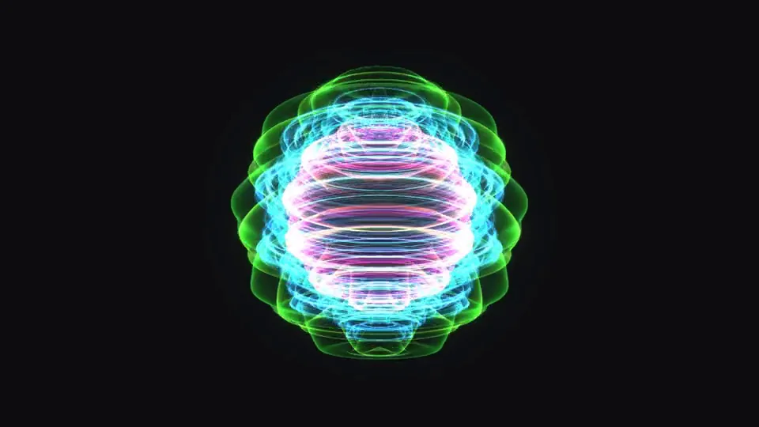
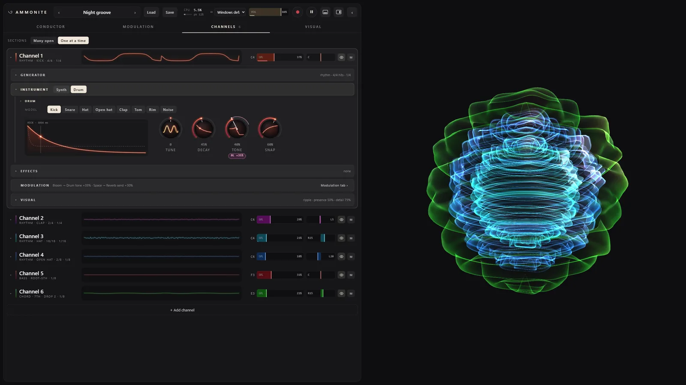
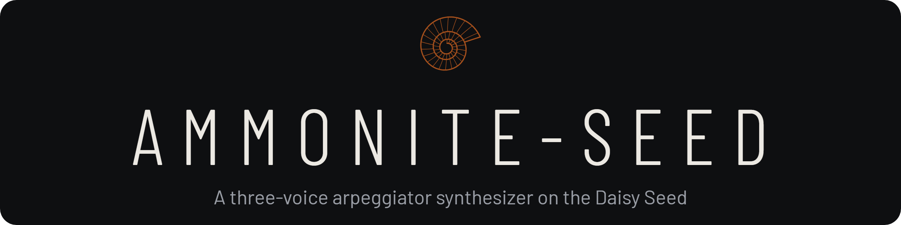
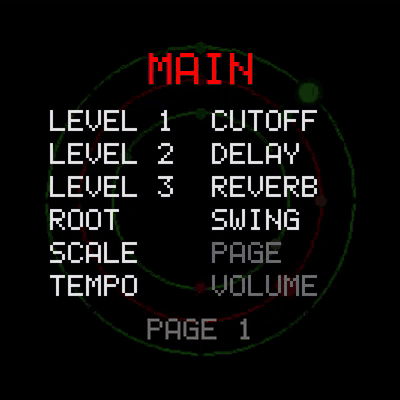
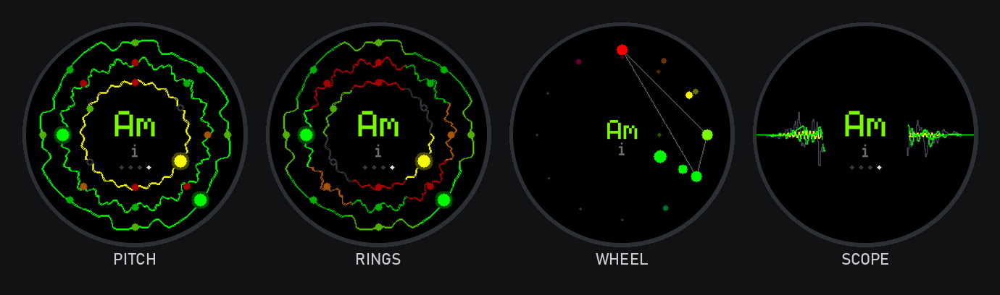
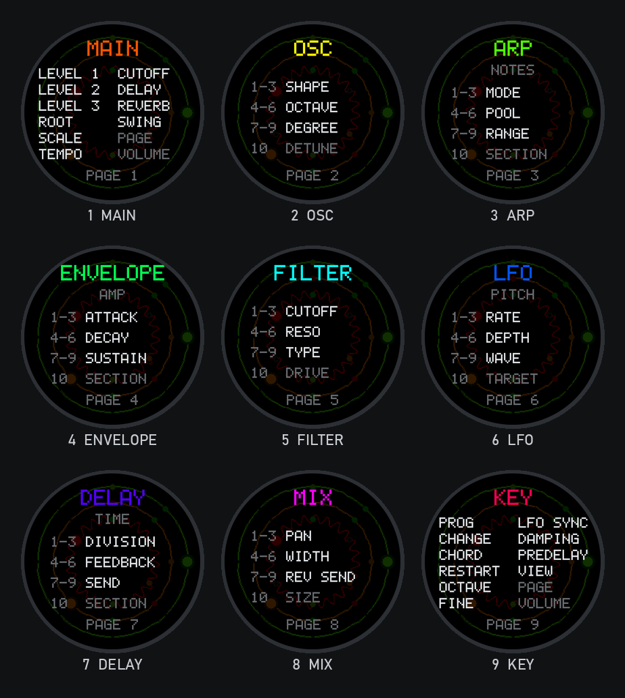
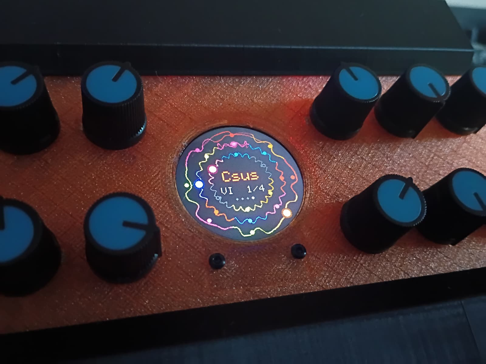
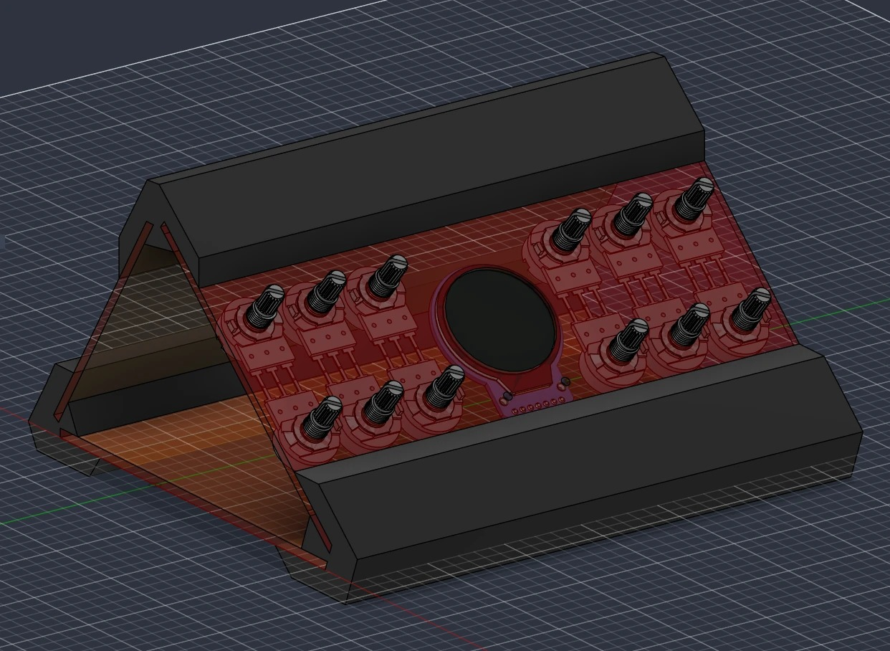
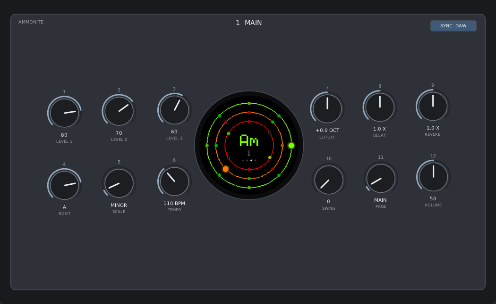

<h1 align="center">Ammonite</h1>

<p align="center">
  <b>A family of arpeggiators that stay in rhythm and key, with strong visuals</b>
</p>

<p align="center">
  <a href="https://gsnautilus.github.io/ammonite/desktop/"></a>
</p>

<p align="center">
  <a href="https://gsnautilus.github.io/ammonite/"><b>The Ammonite family page</b></a> &middot;
  <a href="https://gsnautilus.github.io/ammonite/seed/">&#9654; Listen to Ammonite-Seed</a>
</p>

Ammonite is a family of arpeggiator synthesizers. You set a key, a chord progression
and a rhythm for each part, and everything it plays stays in key and in time. Each version
draws the music as it plays. There are three: a Windows app and plugin (VST3 and CLAP) with up
to 16 channels and a 3D display, the original hardware synth with twelve knobs and a round
screen, and an Android tablet app.

| | | |
|---|---|---|
| **[Ammonite Desktop](#ammonite-desktop)** | Windows standalone, VST3 and CLAP: up to 16 channels of arps, chords, bass and synthesized drums, LFOs and macros, and a 3D stage drawn from the audio | [Download 0.1.0](https://github.com/GSNautilus/ammonite/releases/tag/desktop-v0.1.0) &middot; [page](https://gsnautilus.github.io/ammonite/desktop/) &middot; [`desktop/`](desktop) |
| **[Ammonite-Seed](#ammonite-seed)** | the original: three voices, twelve knobs and a round screen on an Electrosmith Daisy Seed, plus the same synth as a VST3 / CLAP plugin | [Firmware and plugin 0.2.0](https://github.com/GSNautilus/ammonite/releases/tag/v0.2.0) &middot; [page](https://gsnautilus.github.io/ammonite/seed/) &middot; [manual](manual/Ammonite_Manual.pdf) |
| **Ammonite Mini** | Desktop's engine and panel on an Android tablet, laid out for touch | [`ammonite-mini`](https://github.com/GSNautilus/ammonite-mini) &middot; [page](https://gsnautilus.github.io/ammonite/mini/) |

## Ammonite Desktop

<p align="center"></p>

Ammonite Desktop is the Windows version. Where the Seed has three voices and twelve knobs,
Desktop has up to 16 channels, each with its own generator, instrument and effects.

- **Up to 16 channels**, each a generator (Arp, Chord, Bass or Rhythm) driving an instrument
  (a synth voice or one of eight synthesized drums, no samples), with its own drive, chorus and delay
- **The conductor**: key and scale on a circle of fifths, a library of progressions or your
  own, tempo and swing; in a DAW it follows the host's tempo and transport
- **Modulation**: 32 LFOs and 16 macros routed onto any knob, every route shown on the knob it moves
- **A mix bus**: a shared reverb, ducking, glue and a limiter; record straight to WAV
- **The stage**: a 3D display that turns each channel's waveform around an axis into a shell,
  sized by its level and coloured by the note it plays
- **Ten factory presets**, and patches saved as `.ammo` files that also open on Ammonite Mini

**Get it:** [Ammonite Desktop 0.1.0](https://github.com/GSNautilus/ammonite/releases/tag/desktop-v0.1.0),
for Windows 10 and 11 (64-bit): the standalone app, the VST3 and the CLAP in one zip. The
[Desktop page](https://gsnautilus.github.io/ammonite/desktop/) has the install steps and more screenshots.

**Build it** with the Visual Studio 2022 Build Tools (the C++ workload, with CMake). In
PowerShell, from a `--recursive` clone:

```powershell
.\desktop\desktop.ps1 build              # desktop\build\cmake\bin
.\desktop\desktop.ps1 run                # the standalone app, playing through the default output
.\desktop\desktop.ps1 test -Only engine  # the engine's headless tests (Python with numpy)
```

The engine (`desktop/engine/`) is portable C++ with no plugin code in it; the panel is a
web page (`desktop/plugin/web/`) drawn by WebView2 inside a plugin built on
[DPF](https://github.com/DISTRHO/DPF), and the standalone app is a small CLAP host of its
own (`desktop/host/`, WASAPI output) that runs that same plugin.

## Ammonite-Seed

<p align="center">
  <a href="https://gsnautilus.github.io/ammonite/seed/"></a>
</p>

<p align="center">
  
</p>

<p align="center">
  <b>A three-voice arpeggiator synthesizer on the Daisy Seed</b><br>
  12 knobs &middot; a 240x240 round screen that draws the music &middot; chords, polyrhythms and stereo echo
</p>

<p align="center">
  <a href="https://gsnautilus.github.io/ammonite/seed/"><b>&#9654; Listen: two minutes of Ammonite-Seed</b></a><br>
  <a href="https://gsnautilus.github.io/ammonite/seed/#video">Watch the screen play (video with sound)</a> &middot;
  <a href="manual/Ammonite_Manual.pdf">Owner's manual (PDF)</a> &middot;
  <a href="#play-it-in-a-daw-vst3--clap-windows">VST3 / CLAP plugin</a>
</p>

Ammonite-Seed is three monophonic synth voices, each with its own arpeggiator, envelopes,
filter, five LFOs and stereo echo, all on one master clock and in one key. You set a key,
a chord progression and, for each voice, which notes of the chord it may play and in what
rhythm. Everything it plays is in key, and the three patterns can run at different lengths
and speeds while staying on the same clock.

The round screen shows the three arps as rings: each ring is that voice's waveform, cut
into its steps, with every note in its own color (the colors follow the circle of fifths).

- **Three voices**, each two detuned oscillators morphing sine / square / saw
- **Three arpeggiators**: 6 modes, 5 note pools, 1-3 octaves, 9 divisions incl. triplets,
  1-16 step patterns, Euclidean density, random note variation, ratchets
- **Harmony**: 10 scales and 10 chord keys, 8 chord progressions, manual chords
- **Per voice**: amp, filter and pitch envelopes, glide, a morphing LP/BP/HP filter,
  15 LFOs in all (pitch, cutoff, amp, pan, shape), a tempo-synced stereo delay
- **Shared**: drive, reverb, swing, four screen views
- **No menus**: nine pages of knobs, one column per voice

### Listen

**[&#9654; Two minutes of Ammonite-Seed](https://gsnautilus.github.io/ammonite/seed/)**

That and every clip below play in your browser on the
[listening page](https://gsnautilus.github.io/ammonite/seed/). The recipes are rendered
straight from the synth engine, 40 seconds each; every one is in the
[owner's manual](manual/Ammonite_Manual.pdf), so you can dial it in yourself.

| | |
|---|---|
| [Power-on](https://gsnautilus.github.io/ammonite/seed/#power-on) | what Ammonite-Seed plays the moment it has power: three arps in A minor |
| [Slow tide](https://gsnautilus.github.io/ammonite/seed/#tide) | three drones sliding through a progression under a breathing filter |
| [Clockwork](https://gsnautilus.github.io/ammonite/seed/#clockwork) | sixteenth-note patterns of 8, 7 and 5 steps turning against each other |
| [Dub echoes](https://gsnautilus.github.io/ammonite/seed/#dub) | a sparse chord stab into a dark, wobbly ping-pong echo over a sine bass |
| [Late set](https://gsnautilus.github.io/ammonite/seed/#jazz) | a swung ii-V-I in C with a gliding bass |
| [Bells in D](https://gsnautilus.github.io/ammonite/seed/#bells) | Pachelbel's chords played by pitch-swept sine bells |

### The screen

<p align="center"></p>

Turn a knob and the screen shows what it is and its value; turn the page knob and it
shows what every knob on the new page does:

<p align="center"></p>

### Hardware

<p align="center"></p>
<p align="center"><i>The front panel, assembled and playing.</i></p>

<p align="center"></p>
<p align="center"><i>The printed enclosure, version 1.</i></p>

Version 1 of the hardware is simple, and meant to be built with a soldering iron and a
breadboard:

- an Electrosmith **Daisy Seed3**
- a **GC9A01 1.28" round 240x240 display**, 7-pin SPI module
- **12 x WH148 B10K** linear potentiometers (15 mm shaft) with knobs
- a 3.5 mm stereo jack for the output, a breadboard and jumper wire
- a **3D-printed enclosure**: six parts in [`hardware/stl`](hardware/stl)
- USB-C for power and flashing

The wiring is in [`hardware/wiring`](hardware/wiring). A full hardware manual (parts,
printing, assembly, wiring, flashing) is on the [to-do list](#to-do); the enclosure will
keep changing (side panels, a proper home for the jack), so treat this as version 1.

### Getting started

#### Flash the firmware

1. Download `ammonite.bin` from the [Ammonite-Seed 0.2.0 release](https://github.com/GSNautilus/ammonite/releases/tag/v0.2.0).
2. Put the Seed in bootloader mode: hold **BOOT**, tap **RESET**, release **BOOT**.
3. Open the [Daisy Web Programmer](https://flash.daisy.audio/) in Chrome or Edge, connect,
   choose the file and flash.

#### Build from source (Windows)

You need the [Daisy toolchain](https://github.com/electro-smith/DaisyToolchain/releases)
and [Git for Windows](https://gitforwindows.org/). In PowerShell:

```powershell
git clone --recursive https://github.com/GSNautilus/ammonite
cd ammonite
.\ammonite.ps1 libs     # once: builds libDaisy and DaisySP
.\ammonite.ps1 build    # firmware\build\ammonite.bin
.\ammonite.ps1 flash    # build and flash over USB (bootloader mode first)
```

#### Try it without hardware

The PC simulator runs the exact same engine and draws the exact same screen, with the
panel's twelve knobs under your mouse. It needs Python 3.11 with the packages in
[`requirements.txt`](requirements.txt):

```powershell
pip install -r requirements.txt
.\simulator.bat
```

(If the right `python` is not on your PATH, set `AMMONITE_PYTHON` to its `python.exe`.)
`.\ammonite.ps1 test` runs the engine's 193 headless checks.

#### Play it in a DAW (VST3 / CLAP, Windows)

<p align="center"></p>

Ammonite-Seed is also a plugin for Windows DAWs, with the same engine, panel and screen as
the hardware (its copy of the engine is checked bit for bit against the firmware's).
It is the Seed in a DAW, not [Ammonite Desktop](https://gsnautilus.github.io/ammonite/desktop/),
which is a separate, bigger instrument.

1. Download `Ammonite-0.2.0-win64.zip` from the [Ammonite-Seed 0.2.0 release](https://github.com/GSNautilus/ammonite/releases/tag/v0.2.0)
   and unzip it.
2. Copy the `Ammonite.vst3` folder into `C:\Program Files\Common Files\VST3`, and/or
   `Ammonite.clap` into `C:\Program Files\Common Files\CLAP`.
3. Rescan plugins in your DAW and load Ammonite on an instrument track.

It plays by itself as soon as it is loaded. **SYNC DAW** (the default) follows the
DAW's tempo and bars: patterns and chord progressions line up with the song and follow
the playhead; **SYNC FREE** runs on its own TEMPO knob like the hardware. Every knob of
every page is an automatable parameter, saved with the project; turning a knob on the
panel records automation. Any sample rate from 44.1 to 192 kHz.

Tested in FL Studio 2025. Good to know: Ammonite's bars are always 4/4, and it ignores
MIDI notes, so a DAW's channel mute (which mutes by holding back notes) does not
silence it: mute or turn down its mixer track instead.

To build it yourself you need the Visual Studio 2022 Build Tools (the C++ workload, with
CMake). In PowerShell, from the repository:

```powershell
.\plugin\plugin.ps1 build     # plugin\build\cmake\bin\Ammonite.vst3 and Ammonite.clap
.\plugin\plugin.ps1 install   # copies both into the system plugin folders (run as administrator)
.\plugin\plugin.ps1 test      # the engine and plugin tests
```

### To do

- [ ] **Hardware manual**: parts list, printing, assembly, wiring and flashing, with photos
      of the build
- [ ] **Enclosure v2**: back and side panels with room for the jack and USB
- [ ] **Measure CPU load on the Seed** with every effect running
- [x] **VST3 / CLAP plugin** for Windows, synced to the DAW's tempo (0.2.0)

## Repository

| Folder | |
|---|---|
| `desktop/` | **Ammonite Desktop**: `engine/` (portable C++), `plugin/` (DPF + the web panel), `host/` (the standalone app), `test/`, and its build (`desktop.ps1`) |
| `core/` | the Seed's synth engine: portable C++14, no hardware code. Everything musical lives here |
| `firmware/` | the thin Daisy shell: knobs in, audio and screen out |
| `sim/` | the Seed's PC simulator (Python + the engine as a DLL) |
| `tests/` | headless tests that play the Seed's engine and measure what comes out |
| `plugin/` | the Seed as a VST3 / CLAP plugin (DPF): its copy of the engine, the panel UI, its tests |
| `manual/` | the Seed's owner's manual: its screen captures are made by driving the engine |
| `hardware/` | enclosure STLs and wiring diagrams |
| `media/` | the Seed's pictures and audio on this page, rendered by `media/make_media.py` |
| `lib/` | libDaisy and DaisySP (git submodules; DPF is in `plugin/lib/` and `desktop/lib/`) |
| `index.html`, `seed/`, `mini/`, `site.css` | the [GitHub Pages site](https://gsnautilus.github.io/ammonite/) (Desktop's page is `desktop/index.html`) |

## License

Ammonite is released under the [MIT license](LICENSE), copyright Garrick Salois.

It builds on third-party code that keeps its own license: libDaisy and DaisySP (MIT), DPF (ISC)
and, inside it, CHOC (ISC), the CLAP headers (MIT) and Microsoft's WebView2 loader (BSD-3-Clause).
The Seed's reverb, `ReverbSc`, comes from [DaisySP-LGPL](https://github.com/electro-smith/DaisySP-LGPL)
and is licensed under the **LGPL-2.1**: it is linked into the firmware, the simulator and the Seed
plugin, and its full source is in this repository. [THIRD-PARTY.md](THIRD-PARTY.md) lists each one,
where it is used and where its license text is.
